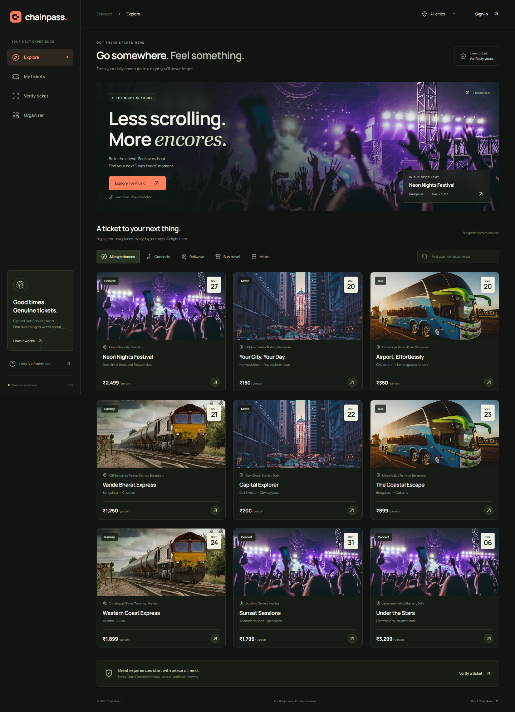
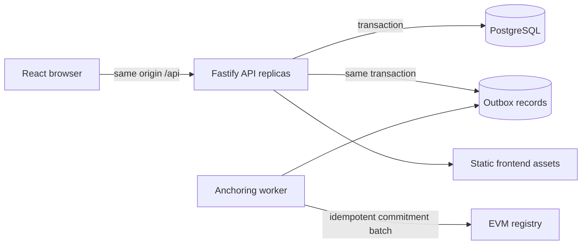

# ChainPass

**One pass. More possibilities.** A full-stack ticketing platform for concerts, rail journeys, buses, and metro services, with private ticket wallets, signed QR admission, organizer operations, and optional on-chain proof of issuance.

Built with React, TypeScript, Fastify, PostgreSQL / SQLite, and Solidity. Local development runs without Docker, a wallet, a cloud account, or a blockchain node.



> Checkout is a clearly labelled sandbox: it never charges money. Blockchain anchoring is optional and never simulated. The included contract is a commitment registry, not an NFT marketplace. Public payment processing, audited smart contracts, and production operations are deployment gates, not claims made by this repository.

## Start locally

Prerequisites: **Node.js 24.x** and npm 11.x, Git. Node 24 is required for the built-in SQLite development adapter. Its experimental SQLite warning is expected.

```bash
git clone https://github.com/manikantbindass/Blockchain-Based-Smart-Ticket-System-Concert-railway-public-and-Private-Transport-.git
cd Blockchain-Based-Smart-Ticket-System-Concert-railway-public-and-Private-Transport-
npm ci
npm run dev
```

Open **http://127.0.0.1:5173**. The API listens on **http://127.0.0.1:4000**; Vite forwards `/api` requests. On Windows PowerShell, use `npm.cmd` if your script execution policy blocks `npm.ps1`.

No `.env` is needed for the local demo. To customize settings, copy `.env.example` to `.env` at the repository root. The API loads this file. Local data persists between restarts; it is ignored by Git.

| Account   | Email                       | Password       |
| --------- | --------------------------- | -------------- |
| Explorer  | `explorer@chainpass.local`  | `Explore123!`  |
| Organizer | `organizer@chainpass.local` | `Organize123!` |

The login dialog also includes demo sign-in buttons. These identities are created only when demo seeding is enabled outside production. New registrations always receive the customer role.

## What works

- Browse and search experiences by category and city, with responsive event details and live availability.
- Register, sign in, restore a session, and sign out; passwords are salted and hashed and session tokens are stored hashed on the server.
- Book sandbox tickets with transactional inventory checks and idempotency keys, preventing overselling and duplicate issuance on retries.
- Book railway journeys through train/class search, passenger entry, Aadhaar-style **test identity** verification, review, simulated payment, seat allocation, and a printable reservation slip. See the [railway walkthrough](docs/RAILWAY-BOOKING.md).
- View personal tickets, display signed QR credentials, inspect issuance proofs, and cancel eligible tickets.
- Verify a ticket code without exposing the customer or the signed admission credential.
- Operate an organizer dashboard, create listings, and check tickets in exactly once, with ownership checks.
- Anchor privacy-preserving ticket commitments on a real local EVM using a durable outbox and a separately run worker.
- Switch from SQLite to PostgreSQL without changing application code.

## Commands

| Command                | Purpose                                            |
| ---------------------- | -------------------------------------------------- |
| `npm run dev`          | Run API and web development servers                |
| `npm run typecheck`    | Typecheck workspaces                               |
| `npm test`             | API invariants and real-EVM contract tests         |
| `npm run build`        | Build API, frontend, and Solidity artifact         |
| `npm run check`        | Typecheck, test, and build                         |
| `npm start`            | Serve compiled API and built frontend on port 4000 |
| `npm run test:e2e`     | Browser workflow tests; see testing guide          |
| `npm run chain:node`   | Start isolated local development chain             |
| `npm run chain:deploy` | Compile and deploy registry to local chain         |
| `npm run worker`       | Process the blockchain outbox                      |

`npm start` requires `npm run build` first. It uses the current environment; set production environment variables deliberately when deploying.

## Enable real local blockchain proofs

The platform works normally with blockchain disabled and shows that state in the UI. To exercise the complete anchoring path:

1. Run `npm run chain:node` in a separate terminal.
2. Run `npm run chain:deploy`. It prints the deployed registry address and writes an ignored local deployment record.
3. Set the chain variables described in [the contract guide](packages/contracts/README.md) and [configuration](docs/CONFIGURATION.md), then restart the API.
4. Run `npm run worker` in another terminal.
5. Book a new ticket. The worker anchors its commitment; refresh the ticket wallet to see the confirmed transaction hash.

Only local test-chain deployments are provided. Development chain keys and accounts have no value and must never be funded on public networks. A transaction proves issuance; current cancellation and admission status remain authoritative in the application database. No personal data or QR secret is stored on-chain.

## Architecture and scaling



For development, SQLite replaces PostgreSQL. Production architecture separates stateless HTTP services from durable data and asynchronous blockchain work. Inventory changes, ticket issuance, and outbox insertion share one transaction. Database constraints, conditional updates, hashed sessions, and indexes provide the foundation for correctness across API replicas.

**Scale is a property to measure.** This repository does not claim a tested throughput or availability SLA. SQLite is for single-process development. Before accepting public traffic, use PostgreSQL, configure gateway-level distributed rate limits, replace sandbox checkout with verified payment webhooks and reservation expiry, establish backups and monitoring, and run load and failover tests. See [architecture](docs/ARCHITECTURE.md), [deployment](docs/DEPLOYMENT.md), and [security](SECURITY.md).

## Project map

```text
apps/
  api/                 HTTP API, storage, migrations, seeds, outbox, tests
  web/                 React UI and bundled image assets
packages/
  shared/              Shared TypeScript API shapes
  contracts/           Solidity registry, ABI, deploy scripts, EVM tests
docs/                  Architecture, API, operations, testing
.github/workflows/     Continuous integration
compose.yaml           PostgreSQL + application containers
Dockerfile             Reproducible Node 24 build
```

## Documentation

- [API contract](docs/API-CONTRACT.md)
- [Railway booking sandbox and its limits](docs/RAILWAY-BOOKING.md)
- [Configuration](docs/CONFIGURATION.md)
- [Architecture and data consistency](docs/ARCHITECTURE.md)
- [Deployment and operations](docs/DEPLOYMENT.md)
- [Testing](docs/TESTING.md)
- [Smart contract](packages/contracts/README.md)
- [Security policy](SECURITY.md) · [Contributing](CONTRIBUTING.md) · [Asset credits](docs/ASSETS.md)

This repository has no license grant yet. Add a license selected by the repository owner before redistributing it as an open-source product.
