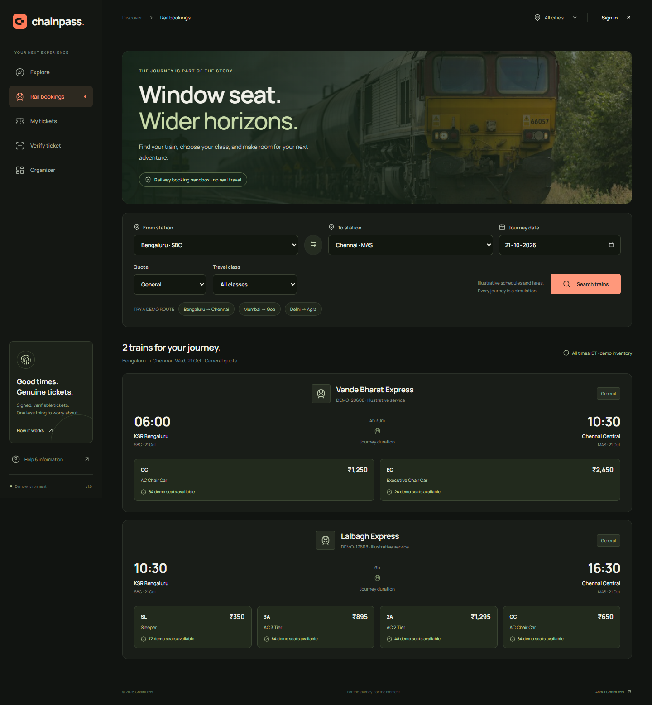

# Railway booking sandbox

Open `http://127.0.0.1:5173/#rail` after `npm run dev`. The Railways category and railway cards also open this flow. It follows the familiar sequence of train search, class availability, passenger entry, account verification, review, payment, and a reservation slip.

This is an independent ChainPass simulator. It is not affiliated with IRCTC, Indian Railways, or UIDAI. Timetables, fares, seats, verification, and payment are demonstration data. A `DEMO-` reservation reference is not an Indian Railways PNR, and the resulting ticket is **not valid for travel**.

## Try the complete journey

1. Sign in with **Demo explorer**, or create a local account.
2. Open **Rail bookings**, choose the stations, journey date, class filter, and General or Tatkal quota. Start with Bengaluru (`SBC`) to Chennai (`MAS`) for tomorrow.
3. Search trains and choose an available class. Inventory belongs to that train, date, class, and quota. The fare is calculated by the server.
4. Enter passengers, a boarding station, and receipt contact details. Each passenger receives a separate ticket and seat in the same reservation. Berth preferences are requests and are not guaranteed.
5. Complete the account identity simulator with a test name, date of birth, gender, consent, and the displayed test OTP. The Aadhaar/VID field is a fixed invalid all-zero identifier; never enter a real Aadhaar or VID. No SMS is sent.
6. Review the journey and passengers, select a simulated payment method, and confirm. No bank, card, or UPI credentials are collected and no money moves.
7. Print the reservation slip or save it as PDF through the browser's print dialog. Open **My tickets** to view individual QR credentials, reopen the slip, or cancel an unused passenger ticket before departure.

Account verification is reusable for that signed-in account. It does **not** authenticate every passenger. Signing out clears the active booking draft. Contact fields appear in the booking request for the simulator; they do not trigger email or SMS delivery.

ChainPass requires this simulated account verification for every railway reservation. That is a demo rule, not a claim that IRCTC requires Aadhaar authentication for every type of booking.

## Deliberate scope

- The demo has a fixed timetable and a 60-day search horizon. It does not query live railway services.
- General reservations allow up to six passengers; the sandbox Tatkal flow allows up to four and only tomorrow's journey date. Real Tatkal opening times and eligibility rules are not modeled.
- The reserved-seat simulator accepts ages 5–120. Infant travel, concessions, special quotas, RAC, waitlists, upgrades, chart preparation, and carrier refund policies are not implemented.
- Allocation happens atomically when the simulated booking is confirmed. Selecting a class does not hold a seat. If another booking consumes availability, confirmation reports the conflict.
- Cancellation releases the exact seat once and invalidates that passenger's QR. It does not initiate a monetary refund.
- Railway booking and identity operations are disabled in production and when demo mode is off. An environment flag cannot enable real Aadhaar or railway access.

## Security and consistency

Identity challenges are scoped to the signed-in user. They expire after five minutes, have at most five attempts, and impose a 30-second resend cooldown. A replacement challenge invalidates the previous one. Successful verification consumes the challenge. The server stores the OTP hash, not the OTP or an Aadhaar number. The API deliberately returns a `demoOtp` in this simulator; it is not an SMS or a real second factor.

The generic event checkout rejects railway events, so it cannot bypass passenger entry or account verification. Railway reservations use the existing authenticated wallet, signed QR, idempotency protection, transactional inventory, and blockchain outbox. Public ticket verification exposes no passenger or identity details. Only opaque ticket commitments go on-chain.

Production integration needs approved identity and railway providers, their documented server-to-server protocols, a real payment provider and verified webhooks, reservation expiry, privacy and retention controls, and a reviewed operational design. Provider credentials alone do not make this simulator a production booking service.

## Reference flow

The workflow was informed by the official [IRCTC e-ticket booking guide](https://contents.irctc.co.in/en/bookEticket.html), [Aadhaar account and passenger authentication guide](https://contents.irctc.co.in/en/aadhaarBookingDoc.pdf), and [Tatkal account authentication guide](https://contents.irctc.co.in/en/MobileAppUserGuideAadhaarAuthenticationForTatkalBooking.pdf). These sources explain the interaction sequence; ChainPass does not claim to reproduce every current fare or booking rule. Real Aadhaar authentication uses UIDAI's authorized ecosystem, described in its [operational model](https://uidai.gov.in/en/operational-model).
